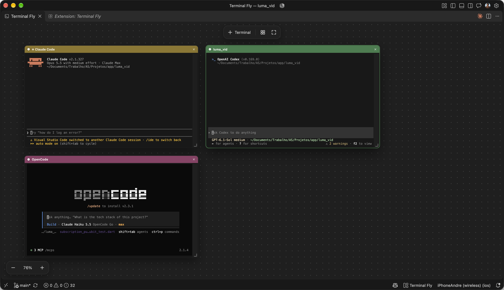

# Terminal Fly

**Free-floating terminals on an infinite canvas, right inside VS Code.**

The built-in terminal panel stacks your terminals in a list, so you only ever see one at a time
(or a couple, side by side). Terminal Fly puts every terminal on a canvas inspired by Apple Freeform:
drag them anywhere, resize them, zoom out and keep an eye on all of them at once.

Every card is a real shell, using your default profile, font and theme.

## Features

- **Infinite canvas** with a dot grid: pan by dragging the background, zoom with pinch or `⌘/Ctrl + scroll`.
  Prefer zooming with the plain mouse wheel? Switch it in the mouse button next to the zoom controls.
- **Floating terminal cards**: drag by the colored title bar, resize from the edges and corners.
- **Arrange in grid** and **Fit all to screen** with one click.
- **Rename** a terminal by double-clicking its title; **change its color** by clicking the dot.
- **Layout is saved per workspace**: positions, sizes, names, colors and camera come back when you reopen.
- Follows `terminal.integrated.*` settings (font family, size, line height, scrollback) and your color theme.
- Clickable links in terminal output.
- Same keyboard shortcuts as the integrated terminal: `Cmd+K` clears, `Cmd+←/→` jumps to line start/end,
  `Option+←/→` moves by word, and shell keys like `Ctrl+R` or `Ctrl+C` stay in the shell.

## Getting started

Open Terminal Fly in any of these ways:

- the layout button in the **Terminal** panel toolbar
- **Terminal Fly** in the status bar
- `Cmd+Alt+`` ` (macOS) / `Ctrl+Alt+`` ` (Windows/Linux)
- Command Palette → **Terminal Fly: Open Terminal Fly**

Then create terminals with **+ Terminal**, by double-clicking the canvas, or with `Ctrl+Shift+`` `
while Terminal Fly is focused. Type `exit` or click `×` to close a terminal.

Tip: drag the Terminal Fly tab out of the window to keep your terminals on a separate monitor.

## Commands

| Command | Description |
| --- | --- |
| `Terminal Fly: Open Terminal Fly` | Open (or focus) the canvas |
| `Terminal Fly: New Terminal` | Add a terminal to the canvas |
| `Terminal Fly: Arrange Terminals in Grid` | Line up every terminal in a grid |
| `Terminal Fly: Fit All Terminals to Screen` | Zoom so every terminal is visible |

## Settings

| Setting | Default | Description |
| --- | --- | --- |
| `terminalFly.defaultWidth` | `680` | Width (px at 100% zoom) of a new terminal |
| `terminalFly.defaultHeight` | `400` | Height (px at 100% zoom) of a new terminal |
| `terminalFly.wheelBehavior` | `pan` | Mouse wheel on the canvas: `pan` moves it, `zoom` zooms in and out (also toggled from the mouse button next to the zoom controls) |
| `terminalFly.restoreLayout` | `true` | Recreate terminals at their saved positions when reopening |

## Notes

- Terminals live inside the Terminal Fly tab: closing the tab ends its shells. When you reopen it,
  the layout comes back with fresh shells.
- Terminal Fly uses the `node-pty` module that ships with VS Code. If it can't be loaded, it falls back
  to a simplified mode where the shell isn't resized along with the card.

## Language

The interface is in English, with a Brazilian Portuguese translation used automatically when VS Code
is set to Portuguese (Brazil).

## License

MIT
